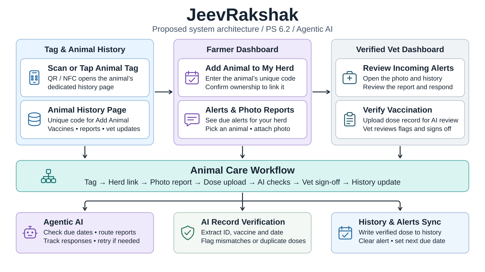

# JeevRakshak

**From an animal tag to a vet-verified care record.**

JeevRakshak is Team Inception’s proposal for helping small dairy households keep track of their animals, act on vaccination alerts, and reach a veterinarian with the right information. A QR or NFC tag opens the animal’s history. The farmer’s dashboard ties that history to a herd, a photo report, and a verified vaccination update.

**Tech4Bharat GAVS 2026 · Round 1 · Problem Statement 6.2 · Agentic AI**

**Status** · Prototype design and demo plan

## One animal. One care loop.

| Step | What happens |
| --- | --- |
| **1 · Scan the tag** | Scan a QR tag or tap an NFC tag to open the animal’s dedicated history page. The tag identifies the animal. Account permissions control access to records. |
| **2 · Link the animal** | Enter its unique code in **Add Animal**. After ownership confirmation, the animal appears in **My Herd**, where the farmer sees vaccination alerts. |
| **3 · Report a concern** | Select the animal, attach a photo, and approve sharing. An available verified veterinarian gets an alert with the report and relevant animal history. |
| **4 · Review the vaccination record** | The vet uploads a completed dose record. AI extracts the animal ID, vaccine and date, then flags missing fields, mismatches and possible duplicates. |
| **5 · Sign off and sync** | A verified vet reviews the flags and signs off. JeevRakshak writes the dose to the animal’s history, clears the corresponding overdue alert, and sets the next due date from the approved schedule. |

## Architecture

The prototype has three main interfaces: the animal history page, the farmer dashboard, and the verified vet dashboard. The workflow agent coordinates them through a shared case record. Vet lookup and messaging are proposed as simulated integrations for the demo.

## What the agent does

- **Detects and plans.** Checks due dates against vetted schedules and prior verified doses, then identifies the next action for the open case.
- **Acts with approval.** Routes the report and approved history to a verified vet after the farmer consents to sharing.
- **Keeps case memory.** Stores the animal ID, request ID, consent and response status. A retry uses the same request ID to avoid a duplicate case.
- **Checks records before publishing.** Extracts fields from the dose record and flags discrepancies for review. Veterinarians retain responsibility for clinical decisions and record sign-off.

## Round 1 demo

Use synthetic records for one animal, one farmer, and one verified veterinarian.

1. Scan a demo tag and confirm that it opens the correct history.
2. Enter the unique code and confirm that the animal appears in **My Herd** with an overdue vaccination alert.
3. Submit a photo report after consent, simulate a failed delivery, and confirm that retrying produces one vet alert.
4. Upload a sample vaccination record with a mismatched animal ID or duplicate dose. Confirm that the AI flags the issue and the record stays pending.
5. Correct the record and approve it as the verified vet. Confirm that the history and farmer alert update only after sign-off.

## Pilot plan

Start with one dairy cooperative and local veterinarians. Test whether farmers can link animals by code and complete a photo report with limited connectivity. Measure herd-link completion, time to vet acknowledgement, on-time vaccination against the pre-pilot baseline, and cost per enrolled animal. Test a cooperative subscription per enrolled herd as the payer hypothesis.

[Read the official livestock-health challenge brief](https://thegavshackathon.com/docs/Tech4Bharat-2026-Problem-Statements.pdf#page=15)
